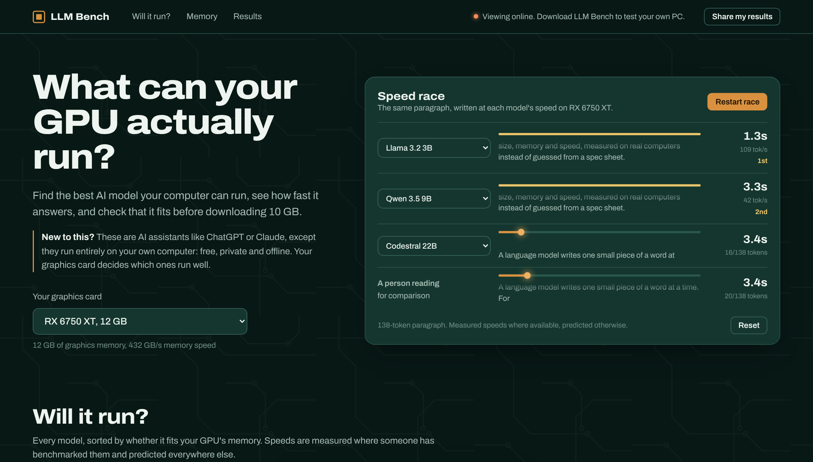

# LLM Bench

Check which local AI models your GPU can run, and how fast, before downloading them.



Local models are multi-gigabyte downloads, and it's hard to tell whether one will run well on your card until you've already downloaded it. LLM Bench benchmarks models through [Ollama](https://ollama.com) and estimates speed for models you haven't downloaded, based on your GPU's memory bandwidth.

## Features

- Detects your GPU and shows which of ~80 popular models fit in its memory
- Estimated speed for every model, replaced by real measurements once you benchmark it
- Download, benchmark and remove models from the browser
- Filter by use case (programming, writing, images, etc.) and compare models side by side
- Speed race: watch the same paragraph stream at each model's speed
- Memory view: see how compression and context length change what fits
- Shareable image of your results

## Running it (Windows)

1. Install [Python 3.11+](https://www.python.org/downloads/) and check "Add python.exe to PATH" during setup.
2. Download this repo and unzip it.
3. Double-click `LLM Bench.bat`.

The site opens in your browser. Ollama is only needed for downloading and benchmarking; estimates work without it.

From the terminal:

```
pip install -r requirements.txt
python run.py             # start the site
python bench.py           # or benchmark from the command line
```

## How the estimates work

Generating a token means reading every active weight from GPU memory once, so speed is mostly limited by memory bandwidth:

```
time per token = model size (GB) / (efficiency * bandwidth) + ~1 ms overhead
```

Efficiency is learned from real benchmark results. The fixed overhead came from my own data: without it, a 0.6B model looked half as efficient as a 9B model on the same card, and with it both come out around 0.55.

Mixture-of-experts models need memory for all their weights but only read some of them per token, so they're handled separately. Models that don't fit in VRAM are estimated by splitting reads between the GPU and system RAM; those estimates are much rougher and the site labels them that way. Accuracy is checked with leave-one-out testing against real results.

## Benchmark method

Each model answers 3 prompts, 3 times each, with identical settings. A few things I had to fix along the way to get consistent numbers:

| Problem | Fix |
|---|---|
| First run includes model load time | Warm-up run before measuring |
| Ollama caches prompts, so repeat runs looked faster | Unique prefix on every prompt |
| Thinking models generate thousands of hidden tokens | `think: false` |
| Long answers hit the context limit | Fixed `num_ctx` and an output cap |
| One model was ~4% slower because of its `presence_penalty` default | Same sampling settings for every model |

## Stack

Python, FastAPI, SQLite and plain JavaScript (no build step).

```
bench.py            benchmark logic (CLI + used by the server)
server.py           API, database, local download/benchmark jobs
predict.py          speed and memory estimates
run.py              launcher
static/index.html   the site
data/               GPU specs and model list
```

The download and benchmark endpoints only run when the app is started locally, and they reject requests from other sites. SQL is parameterized and user-supplied text is escaped.

## Limitations

- Results are stored locally. A shared public database is next.
- GPU detection is Windows-only.
- The per-token overhead is fitted on very little data so far.
- KV cache sizes are estimated from model size, not each model's architecture.
- GPU specs in `data/gpus.json` are reference values; some partner cards differ.

## License

MIT
